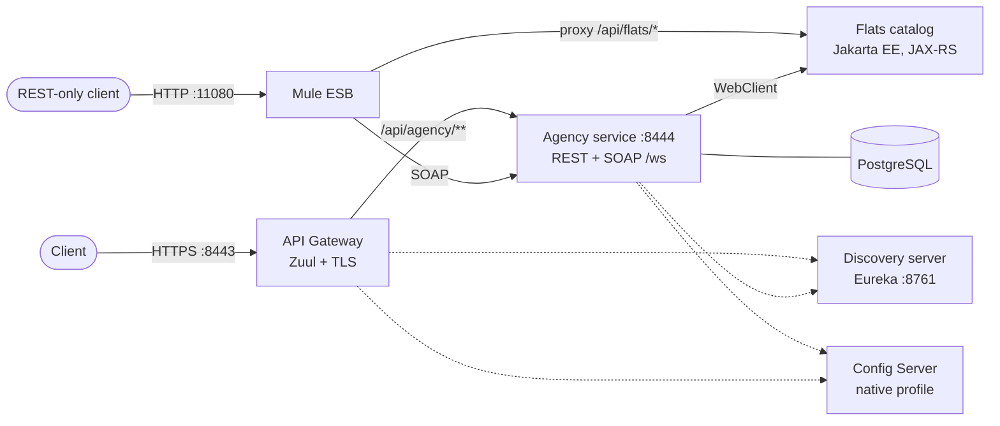

# Realty Agency Cloud

A real estate agency backend built as Spring Cloud microservices. The agency service answers
business questions ("cheapest flat with a balcony", "most expensive of these three") by calling
the [flats catalog](https://github.com/foliageh/realty-flats-service), and exposes the result over
both REST and SOAP. Clients reach it through a TLS gateway, services find each other through Eureka,
and Mule ESB lets REST-only clients use the SOAP contract.

**Stack:** Java 8 · Spring Boot 2.3 · Spring Cloud Hoxton (Eureka, Config Server, Zuul, Ribbon) · Spring WS · WebClient · Spring Data JPA · Spring Security · PostgreSQL · Mule ESB 4 · Gradle (multi-module)

## Architecture



| Module | Port | Role |
|---|---|---|
| `discovery-server` | 8761 | Eureka registry; fast lease renewal so dead instances drop out in seconds |
| `config-server` | — | Shared configuration for all services from a native config repo |
| `api-gateway` | 8443 | Single HTTPS entry point (PKCS12 keystore), routes `/api/agency/**` by service id, load-balanced through Ribbon, response post-processing filter |
| `agency-service` | 8444 | Business endpoints over REST and SOAP, calls the flats catalog through WebClient |

## REST and SOAP from one service

The agency logic lives in one `AgencyService` and is published twice:

- **REST:** `POST /api/agency/find-with-balcony/{cheapest}/{withBalcony}` and
  `POST /api/agency/get-most-expensive/{id1}/{id2}/{id3}`, documented with OpenAPI.
- **SOAP:** a contract-first Spring WS endpoint at `/ws`. The schema in `xsd/agency.xsd` drives the
  generated WSDL (`agency.wsdl`), with operations `findWithBalcony` and `getMostExpensive` and a
  typed error response.

## Mule ESB integration

`soa-lab4-mule-integration.xml` is a Mule 4 application that listens on port 11080 and:

- proxies `/api/flats/*` to the JAX-RS flats catalog unchanged;
- turns plain HTTP calls to `/agency/findWithBalcony` and `/agency/getMostExpensive` into SOAP
  envelopes, sends them to the agency endpoint and maps the SOAP response, errors included, back
  to JSON (Groovy scripting components).

So one client can work with both services through a single REST facade, without knowing that one of
them speaks SOAP.

## Run locally

```bash
./gradlew :discovery-server:bootRun
./gradlew :config-server:bootRun
./gradlew :agency-service:bootRun     # needs PostgreSQL on localhost:5432 and the flats catalog
./gradlew :api-gateway:bootRun
```

Then call `https://localhost:8443/api/agency/...`. Import `soa-lab4-mule-integration.xml` into
Anypoint Studio to run the ESB layer.

---
Built as coursework for the Service-Oriented Architecture course at ITMO University, 2025.
Web client: [Miqvet/soa_lab1](https://github.com/Miqvet/soa_lab1).
